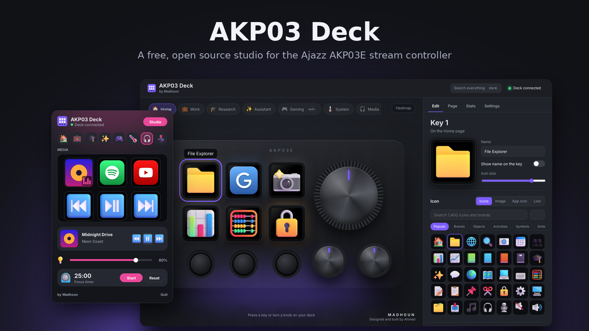
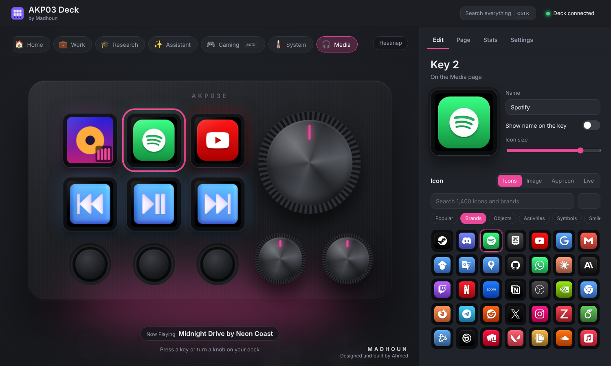
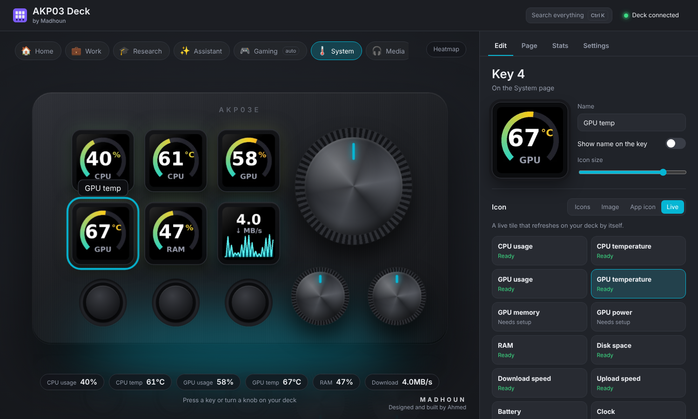
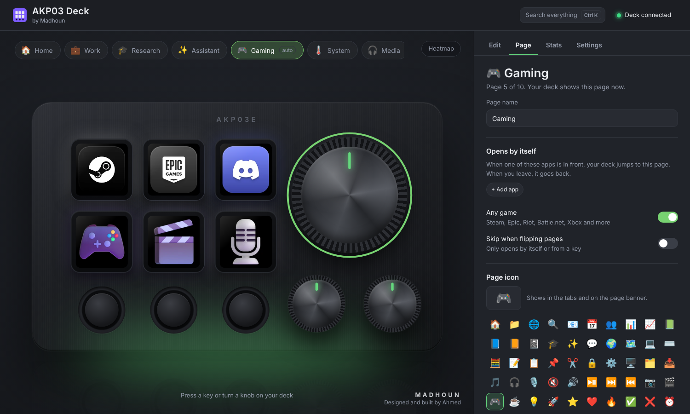
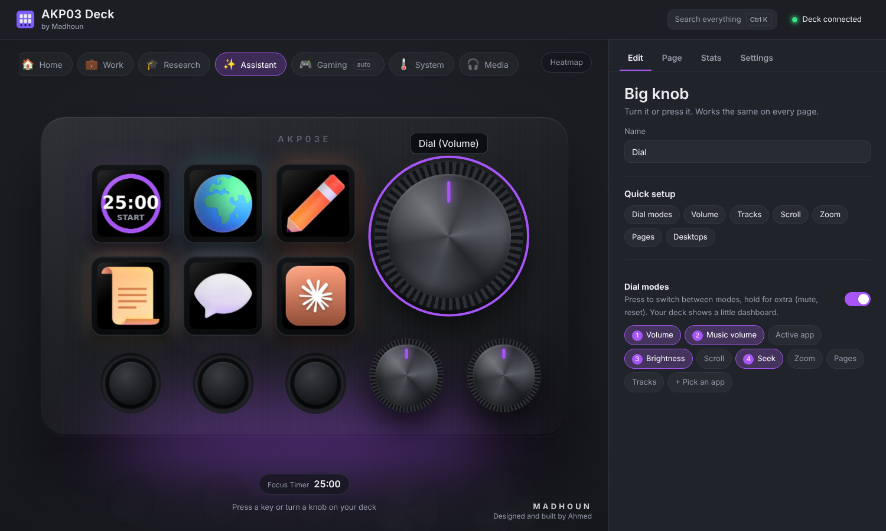
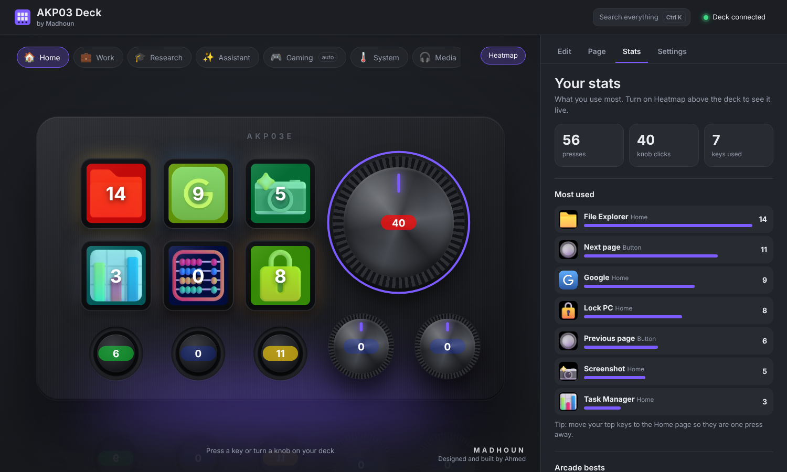
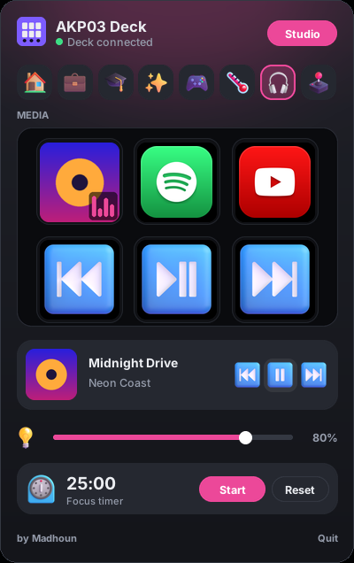
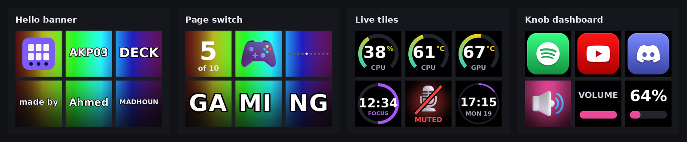

<p align="center">
  
</p>

<p align="center">
  <b>A free, open source app for the Ajazz AKP03E stream controller.</b><br>
  No vendor software. Beautiful 3D icons, live tiles, pages that follow your apps, and knobs that actually do things.
</p>

<p align="center">
  
  
  
  
</p>

---

The AKP03E is a great little device: 6 screen keys, 3 buttons, a big knob and 2 small knobs. The software that ships with it is not so great. **AKP03 Deck** replaces it with a driver written from scratch and a studio you will actually enjoy using.

## What it can do

| | |
|---|---|
|  | **Pro icons out of the box**<br>About 1,400 3D icons and 100 brand tiles, searchable. Installed apps like Excel, Word and Outlook get their real icons automatically. Drop in any image, or an animated GIF that plays on the key. |
|  | **Live tiles**<br>CPU and GPU usage and temperature, RAM, network speed, a clock, a focus timer, mic status and Now Playing with album art. They refresh on the deck by themselves. |
|  | **Pages that follow you**<br>Make as many pages as you like. Open Teams and the Meeting page appears. Open Excel and you get Excel shortcuts. Start a game and Gaming shows up. Leave the app and the deck goes back. |
|  | **Knobs with modes**<br>Press the big knob to switch between system volume, music volume, screen brightness and seek. The bottom row of keys turns into a little dashboard while you turn. Any app can get its own volume knob. |
|  | **Stats and heatmap**<br>See which keys you press most, right on the picture of your deck. Also keeps your best scores in the two mini games you can play on the six screens. |
|  | **Quick panel by the clock**<br>Click the tray icon for a small panel with a live, clickable copy of your keys, page switcher, media controls, volume and brightness sliders and the focus timer. Costs no CPU while hidden. |

And a lot more:

- **Tap, double tap and hold.** Every key and button can do three different things.
- **Macros.** One key can open Outlook, Teams and the calendar, then switch to your Work page.
- **AI keys** (optional, bring your own Claude API key). Select text anywhere, press a key, and it gets translated, polished, summarized or answered, then pasted back.
- **Badges.** Unread Outlook mail count and a muted mic marker in the corner of a key.
- **Ctrl+K** search across pages, keys, settings and actions.
- **Export and import** your whole setup.
- **Starts with Windows** and restarts itself if it ever crashes or stops answering.

### What the deck itself shows

<p align="center"></p>

## Getting started

1. Install [Python 3.10 or newer](https://www.python.org/downloads/). During setup, tick **Add Python to PATH**.
2. Download this project: **Code**, then **Download ZIP**, and unzip it anywhere. Or grab the latest zip from [Releases](../../releases).
3. Close the official Ajazz software if it is running. Only one app can talk to the deck at a time.
4. Double click **`run.bat`**.

The first start takes a minute or two while it installs what it needs. After that, the app lives in the tray next to the clock:

- **Left click** the tray icon for the quick panel.
- **Right click** for the menu: open the studio, reconnect the deck, open the log, quit.

It turns on "Start when Windows starts" the first time, so the deck comes alive by itself after every restart. You can switch that off in the quick panel or in Settings.

> Tip: run `test_device.bat` first if you just want to check the deck is detected. The six keys turn into rainbow colors and every press is printed.

## Using it

**Studio.** Click any key, button or knob on the picture of the deck to edit it. Changes save and appear on the device right away. Drag an image straight onto a key to use it as the icon.

**Library.** Every action box has a Library button with ready made actions: apps, shortcuts, media keys, Teams meeting controls, Excel shortcuts, macros, live tiles and more.

**Pages.** The round Button 1 goes to the previous page and Button 3 to the next one. Any key can also jump to a page, so a key can work like a folder. In the Page tab you can give each page a name, icon, color, wallpaper, RGB glow and the apps that should open it automatically.

**Sleep.** In Settings, **Sleep** turns the deck's screens off after a few minutes without a press or knob turn (Never by default), and **Sleep now** turns them off straight away. The **Sleep deck** action (in the Library under Windows) does the same from a key. Any key, button or knob wakes the deck, and that first press only wakes it: it does not run the key's action.

**Default layout**

| Control | Does |
|---|---|
| Big knob | Turn: volume (or the current mode). Press: next mode. Hold: mute |
| Left knob | Scroll. Press: Task View |
| Right knob | Zoom. Press: reset zoom |
| Button 1 | Previous page. Hold: Home page |
| Button 2 | Play or pause. Double tap: next track. Hold: mute mic |
| Button 3 | Next page |

### Optional extras

| Feature | What it needs |
|---|---|
| CPU temperature, AMD and Intel GPU stats | [LibreHardwareMonitor](https://github.com/LibreHardwareMonitor/LibreHardwareMonitor) running, with Options, Remote Web Server turned on. NVIDIA GPUs work without it. |
| Outlook unread badge | Classic Outlook running |
| Screen brightness knob mode | A laptop screen or a monitor with DDC/CI |
| AI keys | A Claude API key from [console.anthropic.com](https://console.anthropic.com), added in Settings. It stays on your PC in `secret.json`. |

## Supported devices

Tested on the **Ajazz AKP03E** (USB `0300:3002`). These share the same protocol and should work too:

| Device | USB ID |
|---|---|
| Ajazz AKP03E | `0300:3002` |
| Ajazz AKP03R | `0300:1003`, `0300:3003` |
| Ajazz AKP03E/R rev 2, Mirabox N3 rev 2, Soomfon Stream Controller SE | `1500:3001` |
| Mirabox N3 | `6602:1002` |

If yours is not found, run `.venv\Scripts\python app.py --list`, find its line, add the ID to `KNOWN_IDS` at the top of `akp03.py`, and please [open an issue](../../issues) so it can be added for everyone.

## Troubleshooting

**The deck shows pictures but does nothing.** The deck keeps its last pictures as long as it has power, even when no app is driving it. Make sure AKP03 Deck is running (tray icon). If it is, right click the tray icon and choose Reconnect deck.

**It freezes now and then.** The app watches the connection and reconnects by itself within a few seconds, including after the PC wakes from sleep. If it still happens:

1. Plug the deck straight into the PC instead of a hub.
2. Turn off USB selective suspend: Control Panel, Power Options, Change plan settings, Change advanced power settings, USB settings.
3. [Open an issue](../../issues) and attach `akp03.log` and `launcher.log` from the app folder.

**Keys look scrambled.** Open `akp03.py` and change `JPEG_SUBSAMPLING = 0` to `2`.

## How it works

```
 ┌───────────────┐   HTTP + events    ┌───────────────────────────────┐   USB HID   ┌──────────┐
 │ Studio (Edge) │ ◄────────────────► │ app.py  local server + tray    │             │          │
 └───────────────┘   127.0.0.1 only   │ core.py pages, gestures, live  │ ──────────► │  AKP03E  │
 ┌───────────────┐                    │ render.py draws every key      │ ◄────────── │          │
 │ Quick panel   │ ◄────────────────► │ akp03.py one I/O thread,       │  key, knob  │          │
 └───────────────┘   same process     │          flow control, watchdog│   events    └──────────┘
                                      └───────────────────────────────┘
        launcher.pyw starts the app at login and restarts it if it crashes or hangs
```

- **`akp03.py`** is the driver. One thread owns the USB handle, images are queued per key with only the newest kept, sending is rate limited, unchanged images are skipped, and a watchdog reports a stuck connection so the app can reconnect. The wire protocol is written up in [docs/PROTOCOL.md](docs/PROTOCOL.md).
- **`core.py`** holds the config, pages, tap/double tap/hold detection, knob modes, smart pages, live tiles and games.
- **`render.py`** draws every 60 × 60 key image with Pillow.
- **`app.py`** runs a small web server on `127.0.0.1` only, protected by a random token, and serves the studio in `ui/`.
- **`flyout.py`** is the quick panel, drawn with Tk, which ships with Python.

Your setup is saved in `config.json` next to the app.

## Contributing

Ideas, bug reports and pull requests are very welcome. See [CONTRIBUTING.md](CONTRIBUTING.md). Especially helpful:

- Testing on other AKP03 variants and Mirabox clones
- New library actions and live tiles
- Translations of the studio

## Credits

Made by **Ahmed Almadhoun** ([Madhoun](https://github.com/Madhounz)).

Built on the shoulders of:

- [mirajazz](https://github.com/4ndv/mirajazz), [soomfon](https://pypi.org/project/soomfon/) and [codexdeck](https://github.com/sepivip/codexdeck), whose work documented the device protocol
- [Fluent Emoji](https://github.com/microsoft/fluentui-emoji) by Microsoft for the 3D icons (MIT)
- [Simple Icons](https://simpleicons.org) for brand glyphs (CC0)
- [LibreHardwareMonitor](https://github.com/LibreHardwareMonitor/LibreHardwareMonitor) for temperatures

See [THIRD_PARTY_NOTICES.md](THIRD_PARTY_NOTICES.md) for licenses.

## License

[MIT](LICENSE). Free to use, change and share.

*AKP03 Deck is an independent project. It is not made by or affiliated with Ajazz, Mirabox or any of the companies whose apps it can launch. Brand names and logos belong to their owners and are only used to label shortcuts on your own device.*
